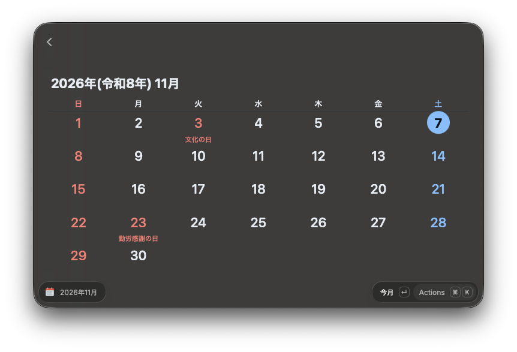

# Quick Calendar JA

日本の祝日に対応した Raycast 用の月表示カレンダーです。
[raycast/extensions の Quick Calendar](https://github.com/raycast/extensions/tree/main/extensions/calendar)（MIT License）をもとにしています。



- 日曜日・祝日は赤、土曜日は青で表示します
- 週の始まり（日曜／月曜）、週番号、祝日名の表示は設定で切り替えられます

## インストール

[pnpm](https://pnpm.io/) と Raycast が必要です。Raycast を起動した状態で:

```sh
git clone https://github.com/lovelovetrb/quick-calendar-ja.git
cd quick-calendar-ja
make
```

Raycast の開発モードで一度ビルドして読み込ませ、すぐに開発モードを終了します。終了後も拡張は Raycast に残ります。
更新するときは `git pull` してからもう一度 `make` を実行してください。

開発時は `pnpm dev` で開発モードを起動すると、保存するたびに再読み込みされます。

## 祝日データ

1. [内閣府「国民の祝日」CSV](https://www8.cao.go.jp/chosei/shukujitsu/syukujitsu.csv) を正とします
   - 拡張機能に同梱したスナップショット（`src/holidays/snapshot.json`）を使い、週に1回バックグラウンドで最新版を取得してキャッシュします
2. CSV に載っていない年（内閣府は翌年分までしか公表しません）は、祝日法のルールから計算した**予測**を表示し、その旨を注記します
   - 春分・秋分の日は近似式で求めます。特別法による祝日の移動（例: 2020・2021年の五輪特例）は予測には反映されません

同梱スナップショットの更新:

```sh
pnpm update-holidays
```
